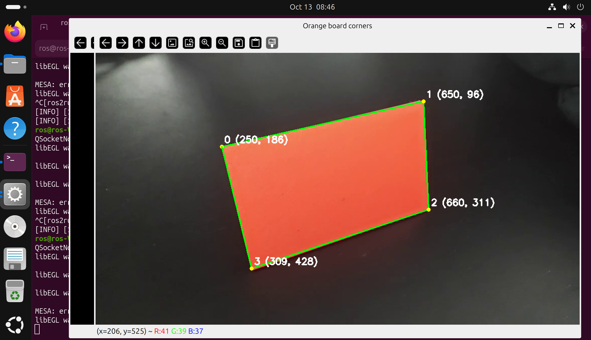

# 视觉感知作业

**最终成果：** 编写程序处理给定视频，在每一帧中寻找橙色板的四个角点，画出点、编号和四边形，并输出逐帧坐标。问题的设计方式是递进的，请不要跳题。



坐标统一使用**原视频像素坐标**：左上角为原点，x 向右、y 向下。若处理时缩小图片，输出和标注前要换算回原尺寸。

建议依次了解 `VideoCapture`、BGR/HSV、`inRange`、滤波、形态学、轮廓与多边形近似；无需一次学完整本 OpenCV 教程。

## 第一问：读取视频，取得每一帧

**输入：** `orange_board.mp4`。

**要求：** 按顺序读取到视频结束，统计实际读到的帧数、尺寸和 FPS；将全部帧保存到 `outputs/frames/`，命名为 `frame_000000.png` 至 `frame_000217.png`。

**输出：** 帧图片和 `outputs/video_info.json`，至少包含 `width`、`height`、`fps`、`frame_count`。实际成功读取的帧数应为 218，不能只读取视频属性就作为处理数量。

**检查：** 打开第 0、109、217 帧，确认顺序、方向和颜色正常。全部帧保留在本地供后续使用。

## 第二问：筛选橙色，生成二值掩膜

**输入：** 第一问提取的第 0、109、217 帧。

**要求：** 转为 HSV，自行选择颜色范围，提取图中所有符合范围的橙色像素；这一问先不只保留最大区域。用掩膜保留原图中对应的颜色，其余位置置黑。

**输出：** 对每张输入保存 `outputs/q2/frame_编号_mask.png` 和 `frame_编号_orange.png`。掩膜必须是原尺寸单通道图片，像素值只有 0 和 255。

**检查：** 橙色板主体能被保留，背景大部分被排除；在报告写出 HSV 阈值，并用一句话解释掩膜中黑、白各代表什么。阈值允许不完美，在实际开发中经常会遇到，保留实际结果即可。

## 第三问：比较滤波、开运算和闭运算

**输入：** 第二问的三张原图和对应掩膜。

**要求：** 固定第二问的颜色阈值，在同一张输入上比较以下结果：

1. 不处理，直接使用原始掩膜。
2. 对原图分别做一次高斯滤波和中值滤波，再做同样的 HSV 分割。
3. 对原始掩膜做一次开运算。
4. 对原始掩膜做一次闭运算。

**输出：** 四张对比图，保存到 `outputs/q3/`；每张图标明四种方法和核尺寸。选择其中一张输入，将一种方法的核尺寸从 3×3 改为 7×7，再保存一次对比。

**检查：** 说明小噪点、孔洞、边缘和角点有何变化。最后选择一种方案用于后续，也可以选择原始掩膜。**尝试过并解释选择即可，不要求滤波或形态学一定改善结果，也不要求把所有操作串在一起。**

## 第四问：从单帧掩膜中找出四个角点

**输入：** 前三问的三张样例帧和选定的分割流程。

**要求：** 提取轮廓，按面积、形状等条件筛选橙色板，拟合四个角点。可参考 `findContours`、`contourArea`、`approxPolyDP`。画的是板子透视形状的四个顶点，不能只把水平外接矩形四角当作板子角点。

**输出：** 每张图片一张标注图和一条 JSON 结果，放在 `outputs/q4/`。检测成功时 `valid=true`，`corners` 有 4 个 `[x,y]`；失败时 `valid=false`，`corners=[]`。

角点按**沿图像顺时针**排列，从 `x+y` 最小的顶点开始；如并列，依次选择 y 更小、x 更小的点。编号为 0、1、2、3，连线顺序为 0→1→2→3→0。

**检查：** 三张样例的角点应贴近板子的真实四角，四边形不能自交。

## 第五问：复用单帧流程，标注整个视频

**输入：** 原始视频和第四问完成的单帧检测函数。

**要求：** 逐帧运行同一流程，检测成功时画四个点、编号和四边形；失败时在该帧标注 `NOT FOUND`。禁止手动填写各帧坐标或把上一帧结果当作本帧检测结果。

**输出：**

- `outputs/annotated.mp4`：960×540、30 FPS，218 帧；每个输入帧都保留，包括失败帧。无需保留音频。
- `outputs/corners.jsonl`：每帧一行 JSON，共 218 行；包含 `frame_index`、`valid`、`corners`。帧号连续且不重复。
- 报告中的成功帧数、失败帧数，以及至少 3 张结果图；有失败时记录帧号和原因分析。

输出示例：

```json
{"frame_index": 0, "valid": true, "corners": [[200,100],[600,80],[620,350],[220,400]]}
{"frame_index": 1, "valid": false, "corners": []}
```

**检查：** 随机查看不同时间位置，图上的点与对应 JSON 坐标一致。目标是在全视频中持续正确标注。

## 学习入口

- [OpenCV：颜色转换与颜色筛选](https://docs.opencv.org/4.x/df/d9d/tutorial_py_colorspaces.html)
- [OpenCV：形态学操作](https://docs.opencv.org/4.x/d9/d61/tutorial_py_morphological_ops.html)
- [OpenCV：轮廓与多边形近似](https://docs.opencv.org/4.x/dd/d49/tutorial_py_contour_features.html)


## 提交与验收

将此仓库fork到自己的github账户下，在分支仓库中提交编写的源码、依赖说明、实际输出和填写后的 [REPORT.md](REPORT.md)。源码可以放在 `src/`，输出放在 `outputs/`。保留题目和原始素材，新增自己的实现。